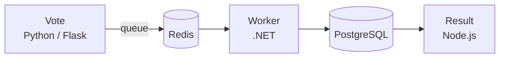
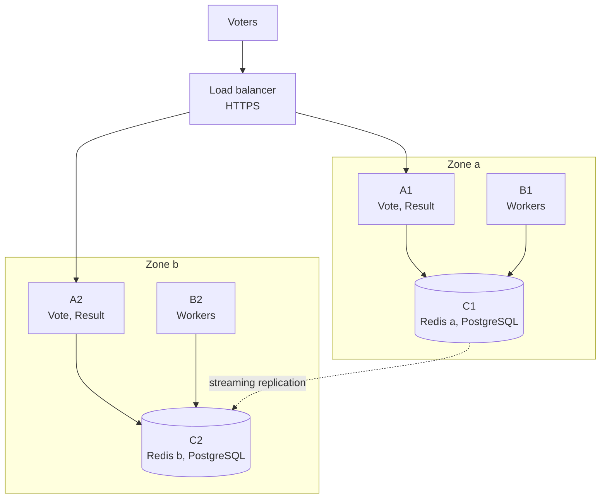

# Voting App: from Docker Compose to two AWS zones

Ironhack DevOps, Project 1 · Evgenia Gridneva

A small voting app made reliable step by step: first broken on purpose and
fixed locally (chaos engineering), then load-tested, then built on AWS with
Terraform and Ansible across two Availability Zones, and finally proven by
switching off a whole zone while votes were coming in.

**Live:** [vote.springlaughing.dev](https://vote.springlaughing.dev) ·
results at [/result/](https://vote.springlaughing.dev/result/)

| Result | Number |
|---|---|
| Spike from the brief: 2,000 votes in 5 seconds, on AWS | all saved, 0 errors, median wait 12 ms |
| A whole zone switched off during voting | 8,855 votes accepted, **8,855 saved, 0 lost** |
| Faults found and fixed with chaos engineering | 7 |

---

## The app



A voter picks a or b on **Vote**, which puts the vote into a **Redis** queue.
The **Worker** takes votes from the queue and saves them in **PostgreSQL**.
**Result** shows the totals live. The queue is the heart of the design: if the
Worker or the database is slow or gone, votes wait safely in Redis instead of
failing (load leveling).

The original app comes from Ironhack's multi-stack voting app template.

---

## What I did

### 1. Chaos engineering: break it on purpose, fix it, prove the fix

Each fault was injected deliberately (kill Redis, restart the database, stop the
Worker …), the damage measured, the cause fixed, and the fix proven by repeating
the same fault. Every fault has its own issue and pull request.

| Fault | Fix |
|---|---|
| Containers that crash stay down | restart policies (`unless-stopped`) |
| Vote crashes with a stack trace when Redis is down | clear error message for the voter, `/health` endpoint that checks Redis |
| Redis restart loses waiting votes | Redis append-only file: the queue survives restarts |
| Worker crash loses the vote in hand; Worker never reconnects | in-progress list (`LMOVE`) and reconnect loops |
| A voter changing their mind creates duplicate rows | unique voter ID + upsert |
| Database password visible in logs and compose file | password in `.env` (not committed), later Ansible Vault |
| Results page freezes after a database restart | reconnect in the results page |

### 2. Load testing with k6

- **Locally:** found where the line forms (Vote vs Workers) and how much the
  queue absorbs.
- **On AWS, the brief's spike** (2,000 votes in 5 s after a minute of normal
  traffic), sent from AWS CloudShell: every vote saved.
- **Finding:** a second Vote server did not make votes faster. Vote ran 5
  gunicorn processes that each handled one vote at a time and mostly waited.
  4 threads per process made the burst **85× faster** (median 1.05 s → 0.012 s)
  on the same machines. Measure before scaling.

### 3. AWS with Terraform and Ansible



- **Network:** one VPC, two zones, three subnet layers per zone (public: load
  balancer and NAT gateway; app: A and B; data: C). Security groups allow only
  the arrows in the picture.
- **Entry:** Application Load Balancer with HTTPS (ACM certificate) on my own
  domain; health checks on `/health`.
- **Servers:** A = Vote and Result, B = Workers, C = Redis and PostgreSQL on its
  own EBS data disk. One of each per zone. No SSH: all access through AWS
  Systems Manager Session Manager.
- **Names, not addresses:** a private Route 53 zone `voting.internal`
  (`redis-a`, `redis-b`, `db-write`, `db-read-a`, `db-read-b`). Each zone uses
  its own Redis; all writes go to `db-write`.
- **Database copy:** PostgreSQL streaming replication from the primary to the
  other zone; the copy follows every change within a second.
- **Configuration:** Ansible over Session Manager installs Docker and runs the
  app; the database passwords come from Ansible Vault.
- **Alarm:** CloudWatch emails me when fewer than 2 Vote servers are healthy.

### 4. Proof: switching off a zone

Zone a (A1, B1, C1) was stopped while k6 sent 10 votes per second. Following
[the runbook](docs/runbook-failover.md): alarm email → confirm C1 is gone →
fence C1 → promote C2 → move `db-write` to C2 → check.

- Voting never stopped: the load balancer moved everyone to A2 within ~30 s
  (144 voters saw an error in that window).
- Saving paused for 15 minutes; meanwhile 7,468 votes waited in Redis b and
  were saved in 10 seconds after the switch.
- **8,855 votes accepted, 8,855 saved, 0 lost.** The last one was waiting in
  zone a's Redis and arrived when zone a came back.
- The way back: C1 rebuilt as the copy of C2. Both zones run again, roles swapped.

---

## Run it locally

Needs Docker with Compose.

```bash
cp .env.example .env          # then set a password in .env (never committed)
docker compose up -d --build
```

Vote: [localhost:8080](http://localhost:8080) · Result:
[localhost:8081](http://localhost:8081)

Load test (k6 in Docker): `bash loadtest/run.sh`

## Deploy to AWS

Needs an AWS account, Terraform, Ansible with the `amazon.aws` and
`community.aws` collections, the Session Manager plugin, and the Ansible Vault
password file outside the repo.

```bash
# 1. once: S3 bucket for Terraform's state
cd terraform/bootstrap && terraform init && terraform apply

# 2. network, load balancer, servers, DNS, alarm
cd ../infra
echo 'alarm_email = "you@example.com"' > terraform.tfvars   # not committed
terraform init && terraform apply

# 3. Docker and the app on all six servers
cd ../../ansible
ansible-playbook site.yml

# 4. once: make C2 a copy of C1
ansible-playbook replica-init.yml -e confirm=yes
```

Failover: [docs/runbook-failover.md](docs/runbook-failover.md).

---

## What's where

| Path | What |
|---|---|
| `vote/`, `result/`, `worker/` | the three app services (with the fixes from chaos engineering) |
| `docker-compose.yml`, `.env.example` | local run |
| `terraform/bootstrap/` | S3 bucket for Terraform state (run once) |
| `terraform/infra/` | VPC, subnets, NAT, security groups, load balancer, certificate, DNS, servers, data disks, IAM, alarm |
| `ansible/site.yml` | installs Docker and deploys the app; database setup on the primary |
| `ansible/replica-init.yml` | one-off: turns a data server into a copy of the primary |
| `ansible/inventory/` | dynamic AWS inventory, variables, encrypted vault |
| `ansible/templates/` | compose files and settings per server role |
| `loadtest/` | k6 scripts, measuring scripts, results of the AWS and failover tests |
| `docs/runbook-failover.md` | step-by-step failover to the other zone and back |

## How I worked

Every change starts as a GitHub issue, gets its own branch and Conventional
Commits, and is merged by a pull request with `Closes #N` (squash merge).
Changes of plan are recorded in the issues.

## Outlook

- Encrypt database connections with TLS (#39)
- Rate limiting / WAF at the load balancer (#30)
- Auto Scaling Groups for the Vote and Worker servers (#23)
- CI pipeline: build, scan and tag images (#22)
- Amazon RDS Multi-AZ and ElastiCache instead of self-run databases:
  automatic failover in 1–2 minutes instead of a manual runbook
- After a failover, point zone a's reads back at its local copy